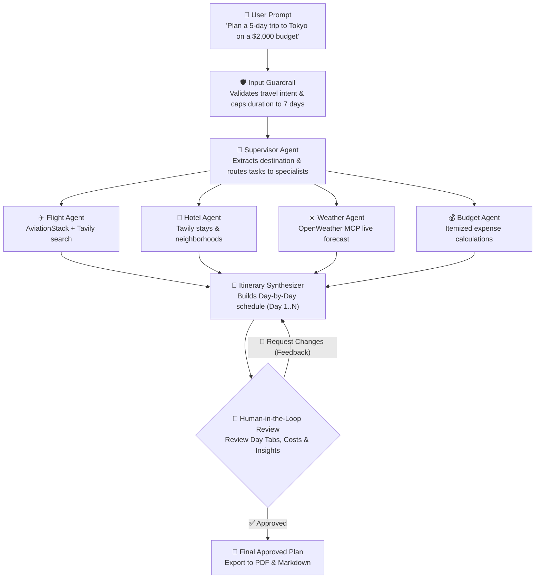

# TravelMind AI — Autonomous Multi-Agent Travel Planner

TravelMind AI is a multi-agent travel planner powered by **LangGraph**, **FastAPI**, **Model Context Protocol (MCP)**, and a **Next.js 16 (App Router) + React 19 + TypeScript** frontend.

Describe your trip in plain English—five specialist agents (**Flights**, **Hotels**, **Weather**, **Budget**, and **Itinerary**) research it live, stream their execution trace in real time, and pause at a **Human-in-the-Loop (HITL)** review gate so you can revise specific days or approve the final plan.

---

## Live Demo

- **Production App:** [https://travelmind-ai-x407.onrender.com](https://travelmind-ai-x407.onrender.com)

---

## How It Works (System Flow)



---

## Key Features

- **Minimal, Editorial UI (`frontend/`):** Next.js 16 App Router + React 19 + TypeScript + Tailwind CSS v4 with light and dark themes (`next-themes`), self-hosted `Geist` / `Instrument Serif` / `Geist Mono` fonts, and mobile responsiveness.
- **Live Agents-at-Work Rail:** Real-time Server-Sent Events (`GET /api/travel/{thread_id}/events`) and snapshot recovery (`GET /api/travel/{thread_id}`) driving the `<AgentRail />` and monospace `<TracePanel />`.
- **Interactive Day-by-Day Review & Approval:** Tabbed itinerary view (`Day 1..N` + `Summary`), time/activity/cost rows, collapsible **Agent Insights** (`Flights`, `Hotels`, `Weather`, `Budget`), and surgical single-day revisions.
- **Human-in-the-Loop (HITL) Gate:** LangGraph `interrupt(...)` state pause that safely waits for user approval or targeted feedback before finalizing.
- **Model Context Protocol (MCP) Multi-Server Client:** Coordinates Tavily (streamable HTTP), AviationStack (stdio subprocess via `uvx`), and an internal OpenWeather FastMCP server (`custom_weather_mcp_server.py`).
- **Resilient Dual-Mode Checkpointer:** PostgreSQL persistence (`PostgresSaver`) with automatic fallback to in-memory checkpointing (`MemorySaver`) for zero-configuration local runs.
- **Safe Markdown & PDF Export:** All LLM outputs sanitized via `rehype-sanitize`, with one-click Markdown copy and light-paper PDF export (`html2pdf.js`).

---

## Project Structure

```text
TravelMind-AI/
├── frontend/                     # Next.js 16 (App Router) + React 19 + TypeScript UI
│   ├── app/                      # (marketing) landing page, (app)/app planner & trip workspace
│   ├── components/               # ui/, brand/, landing/, planner/, agents/, review/, final/, states/
│   ├── hooks/                    # useTripStream, useHealth, useLocalStorage, useReducedMotion
│   ├── lib/                      # Zod schemas, tripReducer state machine, itinerary parser, API client
│   ├── tests/                    # Vitest unit tests + Playwright E2E & axe accessibility tests
│   ├── .env.example              # Frontend environment template
│   └── next.config.ts            # API rewrites & CSP security headers
├── docs/                         # Detailed Architecture & Integration Docs
│   ├── ARCHITECTURE.md           # LangGraph state machine, routing & telemetry deep dive
│   ├── API.md                    # REST endpoints, SSE schemas & cURL examples
│   ├── DEPLOYMENT.md             # Vercel, Render & Docker production guide
│   └── MCP_GUIDE.md              # Model Context Protocol multi-server guide
├── app.py                        # FastAPI service (/api/travel, /events, /approve, /health)
├── backend.py                    # LangGraph multi-agent workflow, checkpointer & SSE event bus
├── mcp_client.py                 # MultiServerMCPClient (Tavily, AviationStack, OpenWeather)
├── custom_weather_mcp_server.py  # FastMCP OpenWeather stdio server
├── requirements.txt              # Python dependencies
├── Dockerfile                    # Container definition
├── .env.example                  # Root backend environment template
└── README.md                     # Project documentation
```

---

## Environment Variables

### Backend (`.env` in repository root)

```env
GROQ_API_KEY=your_groq_api_key
TAVILY_API_KEY=your_tavily_api_key
AVIATION_STACK_API_KEY=your_aviationstack_api_key
OPENWEATHER_API_KEY=your_openweather_api_key
DATABASE_URL=your_postgresql_connection_string

LANGSMITH_TRACING=true
LANGSMITH_ENDPOINT=https://api.smith.langchain.com
LANGSMITH_API_KEY=your_langsmith_api_key
LANGSMITH_PROJECT=TravelMind-AI
```

> **Note:** If `DATABASE_URL` is omitted, the backend automatically runs with an in-memory checkpointer (`MemorySaver`), making local setup instant.

### Frontend (`frontend/.env.local`)

```env
BACKEND_URL=http://127.0.0.1:8000
```

---

## Run Locally

### 1. Start the Python FastAPI Backend (`:8000`)

```bash
# 1. Create and activate Python virtual environment
python -m venv venv

# Windows (PowerShell):
.\venv\Scripts\Activate.ps1
# macOS / Linux:
# source venv/bin/activate

# 2. Install dependencies
pip install --upgrade pip
pip install -r requirements.txt

# 3. Create .env file and paste the backend environment template
cp .env.example .env

# 4. Start FastAPI server
python app.py
```

Verify backend health:
```bash
curl http://127.0.0.1:8000/health
```

---

### 2. Start the Next.js Frontend (`:3000`)

```bash
# 1. Navigate to frontend folder
cd frontend

# 2. Install dependencies
pnpm install

# 3. Create .env.local file
cp .env.example .env.local

# 4. Start development server
pnpm dev
```

Open `http://localhost:3000` for the marketing landing page or `http://localhost:3000/app` for the trip planner.

---

## Testing & Verification

```bash
cd frontend

pnpm typecheck     # TypeScript strict type validation
pnpm lint          # ESLint code style audit
pnpm test          # Vitest unit tests (parser, state machine, XSS sanitization)
pnpm test:e2e      # Playwright E2E + axe WCAG accessibility audit
pnpm build         # Next.js production build
```

---

## In-Depth Documentation

For advanced technical details, explore the dedicated documentation guides:

- [**System Architecture Deep Dive**](docs/ARCHITECTURE.md): Multi-agent state graph, supervisor constraints, selective day revisions, and SSE cursor event bus.
- [**API Reference & Protocol**](docs/API.md): Full OpenAPI specifications, request/response bodies, SSE stream frames, and cURL commands.
- [**Model Context Protocol (MCP) Guide**](docs/MCP_GUIDE.md): Multi-server MCP integration (Tavily HTTP, AviationStack stdio, OpenWeather FastMCP) and diagnostics.
- [**Production Deployment Guide**](docs/DEPLOYMENT.md): Step-by-step setup for Vercel (frontend), Render / Docker (backend), and PostgreSQL.
- [**Frontend Design System Notes**](frontend/UI_NOTES.md): Design tokens, theme palettes, and component architecture.

---

