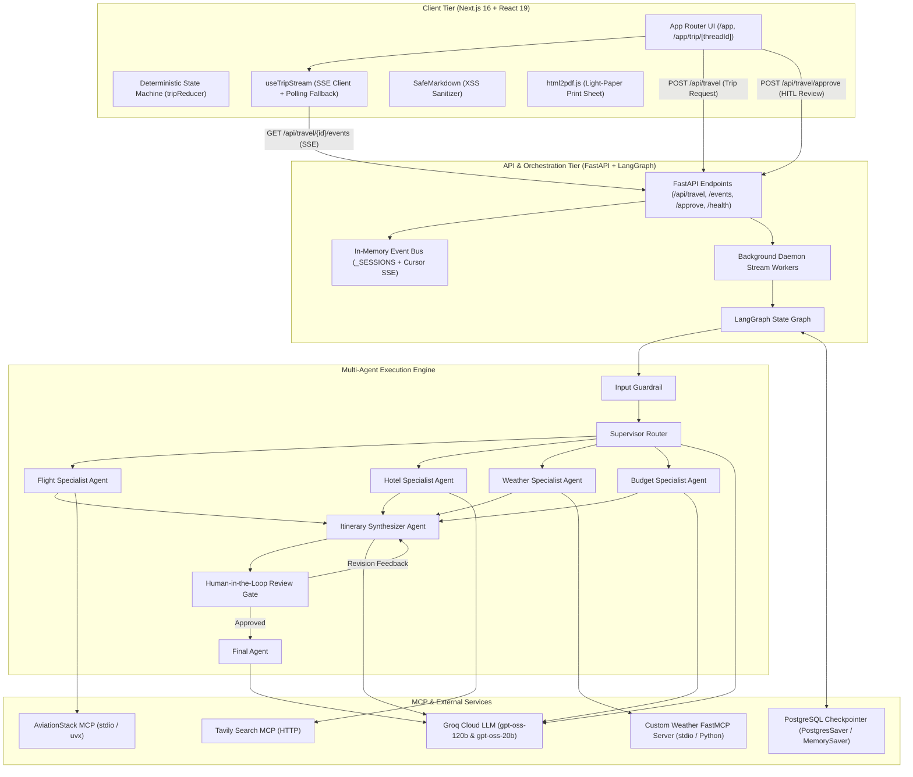
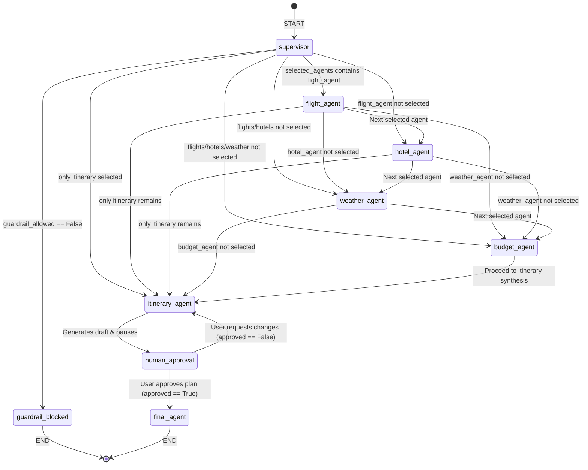
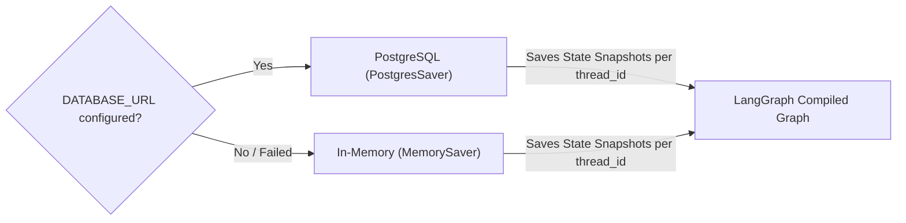
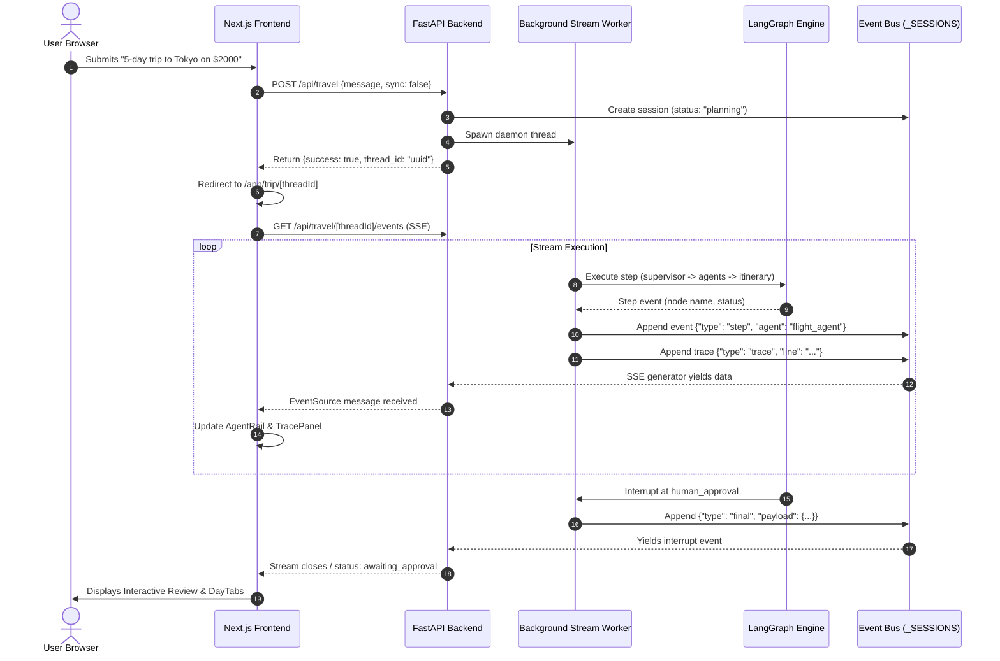

# TravelMind AI — System Architecture & Multi-Agent Design

This document details the architectural design, agent state machine, data flows, and infrastructure behind **TravelMind AI**.

---

## 1. High-Level Architecture

TravelMind AI is structured as a decoupled, modern multi-agent system composed of three primary tiers:



---

## 2. LangGraph State Machine

The core orchestration engine is built on **LangGraph**. The workflow state is tracked using `TravelState`, a structured `TypedDict` that records user queries, guardrail status, routing decisions, specialist findings, approval feedback, and execution traces.

### 2.1 State Definition (`TravelState`)

```python
class TravelState(TypedDict, total=False):
    messages: Annotated[list[AnyMessage], operator.add]
    user_query: str

    # Guardrail and supervisor routing
    guardrail_allowed: bool
    guardrail_reason: str
    selected_agents: list[str]
    trip_constraints: dict[str, Any]
    supervisor_reasoning: str

    # Specialist agent findings
    flight_results: str
    hotel_results: str
    weather_results: str
    budget_results: str

    # Itinerary and Human-in-the-Loop review
    itinerary: str
    approval_request: str
    approved: bool
    human_feedback: str
    final_response: str

    # Execution telemetry
    llm_calls: int
```

### 2.2 Graph Topology & Routing



---

## 3. Multi-Agent Specialist Breakdown

### 3.1 Input Guardrail (`guardrail_agent`)
- **Purpose:** Protects backend resources by screening user queries before any external API or specialist agent runs.
- **Rules:**
  1. **Relevance:** Must belong to travel planning (destinations, flights, accommodations, packing, budgets, activities). Off-topic queries or prompt injections are rejected.
  2. **Duration Cap:** Enforces a maximum trip duration of **7 days** (`MAX_TRIP_DAYS = 7`) to ensure reliable LLM completion within token limits.
  3. **Fail-Open Resilience:** If the guardrail LLM fails to return strict JSON, the request falls open to preserve usability.

### 3.2 Supervisor Agent (`supervisor_agent`)
- **Purpose:** Analyzes the user's travel request, extracts structured constraints, and dynamically routes tasks to required specialist agents.
- **Constraints Extracted:**
  - `destination`: Target city and country
  - `origin`: Departure airport/city (defaults to `DEFAULT_ORIGIN_IATA` if omitted)
  - `duration`: Number of days (1 to 7)
  - `budget`: Budget category (budget, mid-range, luxury) or exact monetary limit
  - `travel_style`: Leisure, adventure, cultural, family, romantic, solo
  - `special_preferences`: Dietary requirements, mobility needs, preferred activities
- **Dynamic Dependency Selection:**
  - If a user only asks about weather and hotels, `flight_agent` is skipped.
  - `itinerary_agent` is always mandatory to assemble the cohesive schedule.

### 3.3 Flight Specialist Agent (`flight_agent`)
- **Tools:**
  - `Aviationstack MCP`: Queries real-time airline flight schedules, routes, and airport data via stdio subprocess.
  - `Tavily Search MCP`: Fallback web research for route price averages, carrier options, and seasonal fare trends.
- **Output:** Formatted flight options with estimated airfares, departure/arrival hubs, and booking guidelines.

### 3.4 Hotel Specialist Agent (`hotel_agent`)
- **Tools:**
  - `Tavily Search MCP`: Live web discovery of boutique hotels, luxury resorts, and budget hostels.
- **Output:** Curated accommodations with neighborhood proximity, amenities, nightly rates, and traveler ratings.

### 3.5 Weather Specialist Agent (`weather_agent`)
- **Tools:**
  - `custom_weather_mcp_server.py`: Custom FastMCP server interfacing with OpenWeatherMap REST API over stdio transport.
- **Capabilities:**
  - `get_current_weather(city)`: Temperature (°C), feels-like, humidity (%), weather condition, and wind speed (m/s).
  - `get_forecast(city)`: 5 intervals of 3-hour forecasts with temperature trends and sky conditions.
- **Output:** Markdown tables summarizing immediate conditions and upcoming forecast for travel packing.

### 3.6 Budget Specialist Agent (`budget_agent`)
- **Purpose:** Compiles an itemized cost projection by synthesizing flight estimates, nightly hotel rates, daily food allowances, and local attraction fees against the user's budget constraint.
- **Output:** Expense tier breakdown and cost-saving recommendations.

### 3.7 Itinerary Synthesizer Agent (`itinerary_agent`)
- **Model:** `MAIN_MODEL` (`openai/gpt-oss-120b`).
- **Prompt Structure:**
  - Synthesizes all specialist outputs into strict Markdown format:
    ```markdown
    ### Day 1 – Arrival & Exploration
    | Time | Activity | Cost |
    |---|---|---|
    | 09:00 AM | Landing & Hotel Check-in | $50 (Taxi) |
    | 01:00 PM | Historic Center Walking Tour | Free |
    | 07:30 PM | Welcome Dinner at Local Bistro | $35 |

    ### Day 2 – Cultural Landmarks
    ...
    ### Trip Summary & Practical Tips
    - **Total Estimated Cost:** $1,250
    - **Transit Tips:** Purchase a 3-day Metro Pass ($18).
    ```
- **Selective Day Revisions:** When the user returns feedback from the HITL gate:
  - `day_selector_llm` identifies the exact days affected by the feedback.
  - `revision_llm` regenerates only the affected days.
  - `_merge_revised_days` surgically replaces the revised day sections while preserving untouched days and the trip summary footer.

### 3.8 Human-in-the-Loop (HITL) Review Gate (`human_approval_agent`)
- **Mechanism:** LangGraph `interrupt(...)`.
- **Workflow:**
  1. The graph pauses after `itinerary_agent` drafts the preliminary schedule.
  2. The state is saved into the checkpointer.
  3. The frontend displays the draft in `<ItineraryView />` with day tabs and specialist insights.
  4. The traveler can:
     - **Approve:** Proceeds to `final_agent` to lock in the trip.
     - **Request Changes:** Submits natural-language feedback (e.g. *"Make Day 3 focus on food tours and reduce Day 2 activity costs"*). The graph loops back to `itinerary_agent`.

### 3.9 Final Agent (`final_agent`)
- **Purpose:** Seals the approved itinerary, produces final travel notes, and marks the session status as `approved`.

---

## 4. State Persistence & Checkpointing

TravelMind AI supports dual checkpointing modes:



### PostgreSQL Checkpointer (`PostgresSaver`)
- Connected via `psycopg` (binary) with `dict_row` row factory and `autocommit=True`.
- Enforces `sslmode=require` for secure remote cloud hosting (Render, Supabase, Neon).
- Configured with `connect_timeout=10` to avoid hangs during initialization.
- Saves state transitions and interrupt payloads indexed by `thread_id`.

### Resilient Memory Fallback (`MemorySaver`)
- When `DATABASE_URL` is omitted (local development, testing) or if the remote database is unreachable, the system automatically falls back to `MemorySaver`.
- Ensures zero boot crashes, zero external dependencies required for quick testing.

---

## 5. Real-Time Streaming Architecture



### Event Bus Specifications
1. **Thread Safety:** `_SESSIONS` dictionary is protected by `_SESSIONS_LOCK` (`threading.RLock`).
2. **Cursor Pagination:** SSE clients track an integer `cursor` counter. If a client disconnects and reconnects, pending events since the cursor are replayed immediately without data loss.
3. **Snapshot Recovery:** If the SSE stream terminates due to serverless infrastructure timeouts (e.g. Vercel 60s execution limit), `useTripStream` seamlessly falls back to polling `GET /api/travel/{thread_id}` every 2 seconds.
