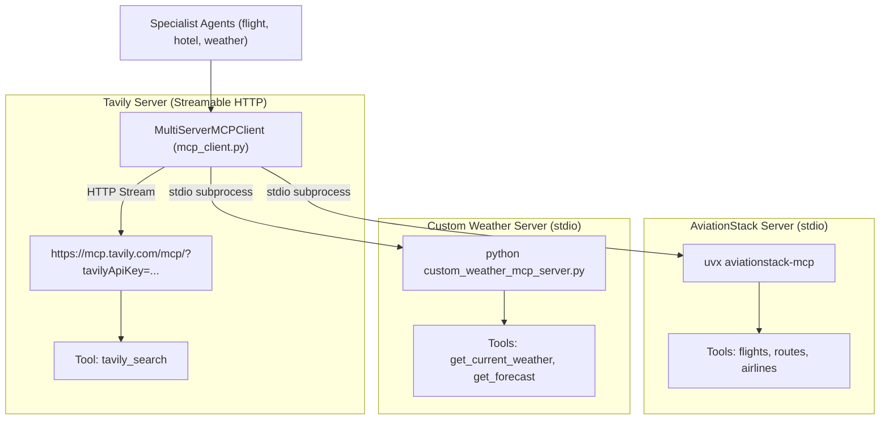

# Model Context Protocol (MCP) Integration Guide

This guide explains how **TravelMind AI** leverages the **Model Context Protocol (MCP)** via `langchain-mcp-adapters` to interface with diverse tool servers across HTTP and stdio transports.

---

## 1. Overview of MCP in TravelMind AI

Model Context Protocol (MCP) provides a standardized protocol for AI models to discover and invoke tools, query external APIs, and execute subprocess tasks safely.

In TravelMind AI, `mcp_client.py` implements a `MultiServerMCPClient` that manages three independent MCP servers:



---

## 2. Server Configurations

### 2.1 Tavily Search MCP
- **Transport:** `streamable_http`
- **Endpoint:** `https://mcp.tavily.com/mcp/?tavilyApiKey={TAVILY_API_KEY}`
- **Primary Tool:** `tavily_search(query)`
- **Role:** High-speed real-time web search for hotels, neighborhoods, sightseeing admissions, and travel advisory notices.
- **Normalization:** Tool output is unwrapped via `_unwrap_mcp_result` to parse structured JSON or clean Markdown text.

### 2.2 AviationStack MCP
- **Transport:** `stdio`
- **Command:** `uvx aviationstack-mcp`
- **Environment:** Subprocess receives `AVIATION_STACK_API_KEY` while inheriting the parent environment.
- **Prerequisites:** `uv` installed (`pip install uv` or native installer).
- **Role:** Searches airline schedules, active flight routes, and airport codes.
- **Resilience:** If `uvx` is not installed or the server fails, `flight_agent` automatically falls back to Tavily web research.

### 2.3 Custom Weather FastMCP Server
- **File:** `custom_weather_mcp_server.py`
- **Framework:** `FastMCP` from the official `mcp` SDK (`from mcp.server.fastmcp import FastMCP`).
- **Transport:** `stdio` (invoked via `sys.executable` pointing to the active virtual environment).
- **Environment:** Passes `OPENWEATHER_API_KEY`.
- **Tools Provided:**
  1. `get_current_weather(city: str)`:
     - Returns: `city`, `temperature_c`, `feels_like_c`, `humidity`, `condition`, `wind_speed`.
     - Request timeout: 20 seconds.
     - Hardened against missing fields and schema discrepancies.
  2. `get_forecast(city: str)`:
     - Returns: 5 consecutive 3-hour forecast slots with `datetime`, `temperature_c`, `condition`.

---

## 3. Server Isolation & Fault Tolerance

A key design pattern in `mcp_client.py` is **per-tool lazy loading** (`_get_server_tool`):

```python
async def _get_server_tool(server_name: str, tool_name: str):
    # Validates required environment variables for the specific server only
    if server_name == "tavily":
        _require_env("TAVILY_API_KEY", TAVILY_API_KEY)
    elif server_name == "Aviationstack MCP":
        _require_env("AVIATION_STACK_API_KEY", AVIATION_STACK_API_KEY)
    elif server_name == "weather":
        _require_env("OPENWEATHER_API_KEY", OPENWEATHER_API_KEY)

    # Loads tools only from the target server
    tools = await client.get_tools(server_name=server_name)
    tool = next((item for item in tools if item.name == tool_name), None)
    if tool is None:
        raise RuntimeError(f"MCP tool '{tool_name}' not found on '{server_name}'.")
    return tool
```

### Benefits:
- **Zero Cascading Failures:** If AviationStack is temporarily down or unconfigured, weather and hotel lookups continue to work without interruption.
- **Subprocess Isolation:** Each stdio server runs in its own process lifecycle. If a server process exits or errors, it does not corrupt the parent FastAPI worker.

---

## 4. MCP Testing & Diagnostics

You can test connectivity to all configured MCP servers independently using the built-in diagnostic test runner:

```bash
# Windows
venv\Scripts\python -c "import asyncio, mcp_client; asyncio.run(mcp_client.get_all_tools())"

# Linux / macOS
venv/bin/python -c "import asyncio, mcp_client; asyncio.run(mcp_client.get_all_tools())"
```

### Expected Diagnostic Output:
```text
tavily: OK -> tavily_search, tavily_extract
Aviationstack MCP: OK -> aviationstack_flights, aviationstack_routes, aviationstack_airports
weather: OK -> get_current_weather, get_forecast
```

If any server fails, `get_all_tools()` prints the exact reason (e.g. missing API key, network timeout) while continuing to verify the remaining servers.
